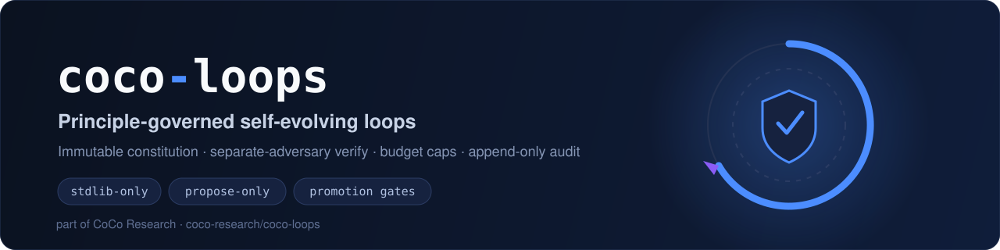
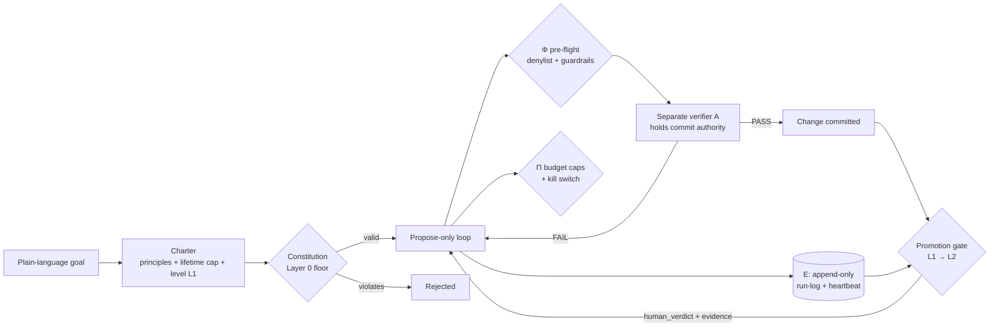

<p align="center">
  
</p>

<p align="center">
  
  
  
  
</p>

<p align="center">
  <b>Wrap autonomous agent loops in an immutable constitution, separate-adversary verification, budget caps, append-only audit, and promotion gates.</b><br>
  <sub>stdlib-only Python · propose-only by default · the maker never grades its own work</sub>
</p>

<p align="center">
  <a href="#install">Install</a> ·
  <a href="#how-it-works">How it works</a> ·
  <a href="#quick-start">Quick start</a> ·
  <a href="#cli">CLI</a> ·
  <a href="#consumer-layer-goal--governed-loop">Goal → loop</a> ·
  <a href="#specs">Specs</a>
</p>

---

## Why

Autonomous loops fail in predictable ways: they grade their own work, run forever, drift from the original goal, and leave no audit trail. **coco-loops** is the mechanical governance layer that makes a loop *safe to leave running* — it does not run the model or make decisions itself, so the governance core stays deterministic and model-free.

A loop is an **agentic contract** `C = ⟨O, K, I, Y, Φ, A, Π, E⟩` under an immutable **constitution** (Layer 0). The core invariant: the maker never holds commit authority — a **separate verifier** (`A`) does.

## How it works



| Symbol | Component | Module |
|--------|-----------|--------|
| **Φ** | Pre-flight denylist + guardrails | `coco_loops.constraints` |
| **A** | Separate-adversary verifier (commit authority) | `coco_loops.verifier` |
| **Π** | Budget caps + kill switch | `coco_loops.budget` |
| **E** | Append-only audit + heartbeat | `coco_loops.run_log` |
| — | Liveness monitoring → revive/escalate | `coco_loops.supervisor` |
| — | L1 → L2 promotion gate | `coco_loops.promotion_gate` |

## Install

```bash
git clone https://github.com/coco-research/coco-loops.git
cd coco-loops
python3 -m venv .venv && source .venv/bin/activate
pip install -e ".[dev]"     # no third-party runtime deps; dev extra installs pytest
```

## Quick start

Register a loop from the template, arm a lifetime cap, and run it propose-only:

```bash
cp specs/loop-contract.template.md loops/my-loop.contract.md   # fill placeholders
coco-loops list                              # contracts, levels, pause state
coco-loops start my-loop --for 4h            # arm lifetime cap + clear kill-switch
coco-loops run my-loop --repo <worktree> --tasks q.json   # propose-only
coco-loops status my-loop                    # run-log + budget
```

Or compile a goal straight into a governed loop (see [Consumer layer](#consumer-layer-goal--governed-loop)):

```bash
coco-loops charter --schema                          # inspect the goal → loop schema
coco-loops charter --from-json - --install < goal.json
```

## CLI

```
coco-loops list                          contracts, levels, pause state
coco-loops status <loop-id>              run-log + budget for one loop
coco-loops start  <loop-id> --for 4h     arm a lifetime cap + clear kill-switch
coco-loops run    <loop-id> --repo <wt> --tasks q.json   run a loop propose-only
coco-loops supervise <loop-id>           one heartbeat check (liveness → revive/escalate)
coco-loops promote <loop-id>             L1 → L2 promotion gate (PASS/FAIL)
coco-loops label  <run-id> <verdict>     record a human_verdict (feeds promotion gate)
coco-loops charter --schema              print the charter schema (goal → loop)
coco-loops charter --from-json - --install   compile a goal into a governed loop
coco-loops verify                        run the framework pytest suite
```

### Configuration

| Flag / env | Purpose | Default |
|------------|---------|---------|
| `--loops-dir` / `COCO_LOOPS_DIR` | Contract discovery (`*.contract.md`) | `./loops` (cwd) |
| `--state-dir` / `COCO_LOOPS_HOME` | Kill-switch, run-log, budget artifacts | `~/.coco` |
| `COCO_LOOP_RUN_LOG` | Override run-log path | `$STATE_DIR/loop-run-log.jsonl` |

`COCO_RUNTIME_DIR` is accepted as a back-compat alias for `COCO_LOOPS_HOME`. The shell shim `bin/coco-loops` delegates to the installed console script.

## Consumer layer (goal → governed loop)

For someone who just wants to state a goal and get a safe loop without wiring the framework by hand: a plain-language goal is compiled into a **charter** (readable principles + a lifetime cap + level L1), validated against the immutable constitution floor, confirmed by the person, then installed as a propose-only loop. The model that compiles the goal lives in the **consumer** (the `/coco-loop` skill or an MCP client); the framework only validates and installs, so the governance core stays model-free. See [specs/consumer-layer.md](specs/consumer-layer.md).

## Registering a consumer loop

1. Copy [specs/loop-contract.template.md](specs/loop-contract.template.md) → `loops/<your-loop>.contract.md` and fill placeholders.
2. Add budget caps in `loops/loop-budget.md`.
3. In your daemon/script:
   - `coco_loops.budget.check_cycle_budget()` — pre-flight
   - `coco_loops.verifier.verify(change, test_runner)` — before commit
   - `coco_loops.run_log.RunLog(path).append(entry)` — audit + heartbeat
4. Optional: `coco_loops.supervisor.decide(...)` for liveness monitoring.
5. Inspect: `coco-loops list` / `coco-loops status <your-loop>`.

See [examples/coding-loop/](examples/coding-loop/) for CoCo's coding-loop adapter (consumer #1).

## Package layout

```
coco_loops/          verifier · budget · run_log · supervisor · promotion_gate · cli · paths
specs/               constitution · constraints · budget · run-log schema · contract template
examples/            worked consumer adapters
docs/                deploy runbook
tests/               framework tests
```

## Specs

| File | Component |
|------|-----------|
| [loop-constitution.md](specs/loop-constitution.md) | Layer 0 (immutable invariants) |
| [loop-constraints.md](specs/loop-constraints.md) | Φ — pre-flight denylist + guardrails |
| [loop-budget.md](specs/loop-budget.md) | Π — caps, kill switch |
| [loop-run-log.schema.md](specs/loop-run-log.schema.md) | E — audit + heartbeat schema |
| [loop-contract.template.md](specs/loop-contract.template.md) | Reusable contract template |

## License

**Proprietary — source-available.** Copyright © 2026 Coco Inc (coco-research). All rights reserved. The source is public for reference; running it locally is permitted, but use, copying, modification, and redistribution require a written agreement. See [LICENSE](LICENSE).

<sub>Part of <a href="https://github.com/coco-research/coco">CoCo Research</a> — open-core AI orchestration &amp; agentic developer tooling.</sub>
